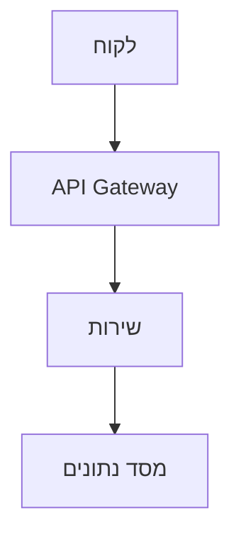

# RFC: {{title}}

| שדה | ערך |
|-----|-----|
| **סטטוס** | טיוטה / בבדיקה / אושר / נדחה |
| **כותב/ת** | |
| **נוצר בתאריך** | {{date}} |
| **סוקרים** | |

## הגדרת הבעיה

איזו בעיה אנחנו פותרים? למה דווקא עכשיו?

## ההצעה

### סקירה כללית

תיאור ברמה גבוהה של הפתרון.

### ארכיטקטורה



### API / ממשק

```typescript
// הממשקים המרכזיים כאן
```

## חלופות שנבחנו

| אפשרות | יתרונות | חסרונות |
|--------|---------|---------|
| ההצעה הנוכחית | | |
| חלופה א' | | |
| לא לעשות דבר | | |

## סיכונים ודרכי התמודדות

- **סיכון:** 
  - **התמודדות:** 

## קריטריונים להצלחה

- [ ] 
- [ ] 

## שאלות פתוחות

- [ ] 
