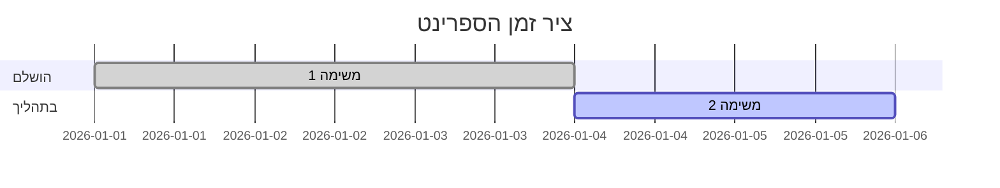

# רטרוספקטיבת ספרינט — ספרינט {{sprint}}

**תאריך:** {{date}}  
**צוות:** 

## 🟢 מה הלך טוב

- 

## 🔴 מה לא הלך טוב

- 

## 💡 רעיונות / ניסויים לנסות

- 

## ✅ משימות לביצוע

| משימה | אחראי/ת | תאריך יעד |
|-------|---------|-----------|
|       |         |           |

## 📊 מדדי ספרינט

